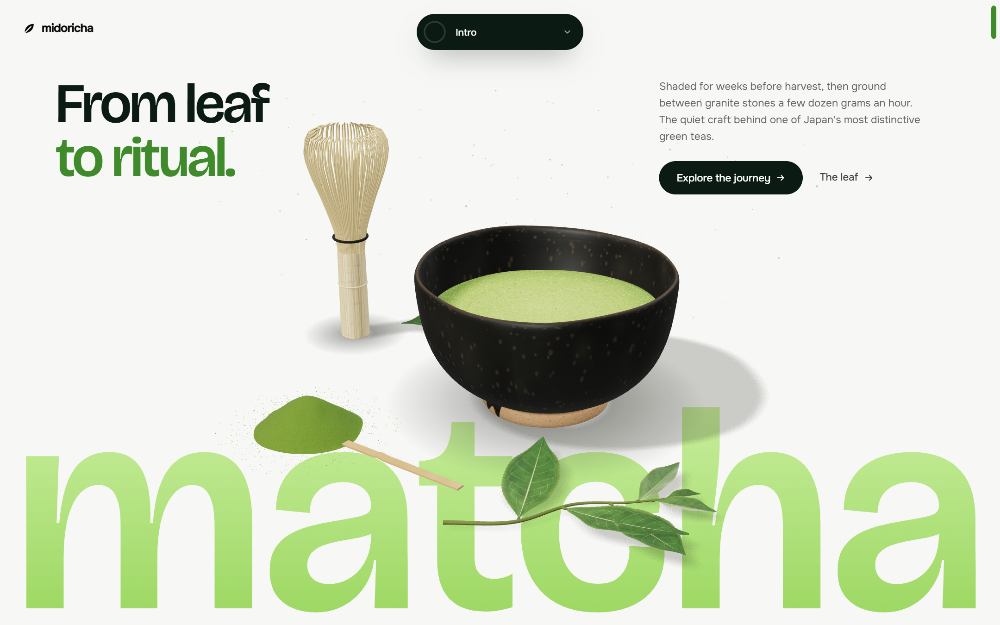

# 緑茶 Midoricha

A scroll story about matcha, told in ten sections: from a single shaded leaf to a bowl whisked by hand.



Built with Nuxt 4 and Three.js. Every object on the page, from the chawan to the stone mill, is modelled in code. The only 3D files are the two hands in the tea room, and there are no stock photos.

## 道 The journey

| | Section | What happens as you scroll |
|---|---|---|
| 序 | **Intro** | A still life of chawan, chasen and fresh leaves sits over the wordmark |
| 葉 | **The Leaf** | The sprig stays pinned while the text lights up word by word and notes appear on the leaf |
| 畑 | **Cultivation** | The camera walks down a misty tea field through shade, harvest, steam, dry and grind |
| 工程 | **Process** | The five steps slide sideways as horizontal cards |
| 石臼 | **Stone Ground** | The granite mill turns, tencha falls in and powder fills the bowl |
| 味 | **Character** | A flavour wheel turns through umami, sweet, grassy, creamy and bitter |
| 歴史 | **History** | Eight centuries of tea, from Tang China and the monk Eisai to Sen no Rikyū, then the four principles 和敬清寂 and 一期一会 |
| 茶道 | **Ritual** | A dark, top down tea setting with steam, followed by the four steps of making a bowl |
| 今 | **Today** | Ceremonial, latte, culinary and creative uses stack on top of each other |
| 始 | **Begin** | Two lines of words drift in opposite directions above a floating leaf |

## 点前 Make a bowl yourself

The page at `/brew` is a small tea room where you prepare the tea yourself. Nothing moves until you do.

| | Step | What you do |
|---|---|---|
| 掬 | **Scoop** | Tap twice to carry matcha from the natsume to the bowl |
| 湯 | **Rest the water** | Slide the dial until the kettle sits around 80 °C |
| 注 | **Pour** | Hold to pour with the bamboo ladle and let go near 70 ml |
| 点 | **Whisk** | Move back and forth over the bowl until the foam is full |
| 出 | **Serve** | Present the bowl to the guest, then take the guest's seat |
| 回 | **Turn** | Drag to turn the bowl so you do not drink from its front |
| 飲 | **Drink** | Hold to lift the bowl and drink until only a trace of foam is left |

Each step explains itself, gives feedback as you go, and only lets you move on once it is done right. A pair of hands does the work in front of you, and the last sip is seen through your own eyes. Whisking and turning also work with the arrow keys.

## 道具 Tools

| | |
|---|---|
| Framework | Nuxt 4, Vue 3, TypeScript |
| 3D | Three.js with procedural geometry, canvas textures and small GLSL shaders |
| Styling | Tailwind CSS 4 |
| Scrolling | Lenis on desktop, native scroll on touch devices |
| Utilities | VueUse |
| Type | Bricolage Grotesque and Onest |

No UI kit and no icon library. Buttons, the navigation island, the scrollbar and every icon are written by hand.

## 始め Getting started

You need Node.js 20 or newer.

```bash
npm install
npm run dev
```

Then open `http://localhost:3000`.

| Command | |
|---|---|
| `npm run dev` | Development server with hot reload |
| `npm run build` | Production build |
| `npm run preview` | Serve the production build locally |
| `npm run generate` | Static export |
| `npx nuxi typecheck` | Type check the whole project |

## 間取り Layout of the code

```
app/
  pages/          the story at / and the tea room at /brew
  layouts/        the story layout and a full screen layout for the tea room
  content/        all copy lives here, edit text without touching components
  types/          shapes of the content
  components/
    base/         buttons, headings, scroll reveal text, marquee, hanko seal
    layout/       navigation island, footer, brand mark
    scene/        the canvas that hosts a 3D scene
    sections/     one folder per section with its own small components
    brew/         panel, stepper and controls of the tea room
  composables/    scroll progress, horizontal scroll, scene loading, brew session
  three/
    core/         renderer stage, lighting, math and noise helpers
    textures/     leaf, bamboo, ceramic, granite and matcha, painted on canvas
    objects/      chawan, chasen, chashaku, stone mill, tea field
    scenes/       one file per 3D scene
    brew/         the interactive tea room scene
    stills/       renders the images for the Today section
  constants/      the rules of the tea room, such as ideal water and temperature
  utils/          device checks and small helpers
```

To change any wording, open `app/content/home.ts`. The components only read from it.

## 心遣い Care for the visitor

1. Each 3D scene loads only when it comes near the screen, and pauses when it leaves.
2. Phones and slower machines get fewer particles, no real time shadows and a lower pixel ratio. Devices without WebGL see a quiet gradient instead of a scene.
3. If the frame rate drops, the canvas lowers its resolution step by step.
4. With reduced motion turned on, smooth scrolling is off and the scenes hold still.
5. All 3D views have text descriptions, the page can be used with a keyboard, and a skip link leads straight to the content.

## 服 A last note

Matcha is ground slowly so the leaf never gets warm. The site was built in the same spirit. There is little on the page, and each part was made with care.

ごゆっくりどうぞ. Take your time.

## 謝辞 Credits

The hand models come from [WebXR Input Profiles](https://github.com/immersive-web/webxr-input-profiles) by the W3C Immersive Web group, released under the MIT license. The tea room bends their joints to hold each tool.
